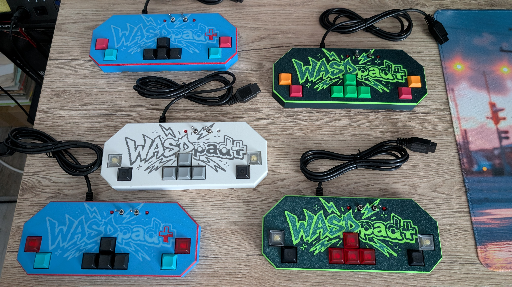
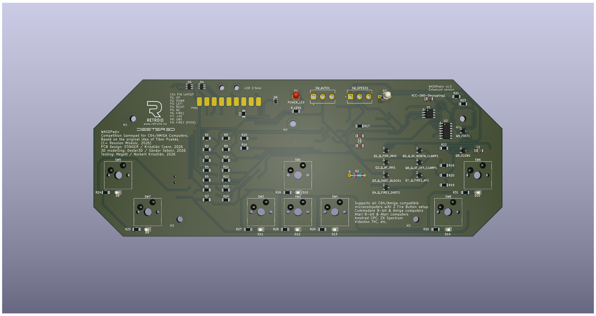
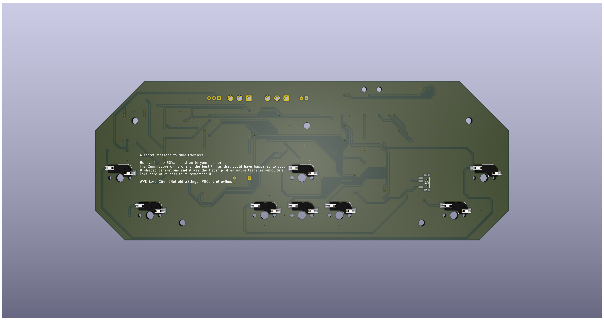
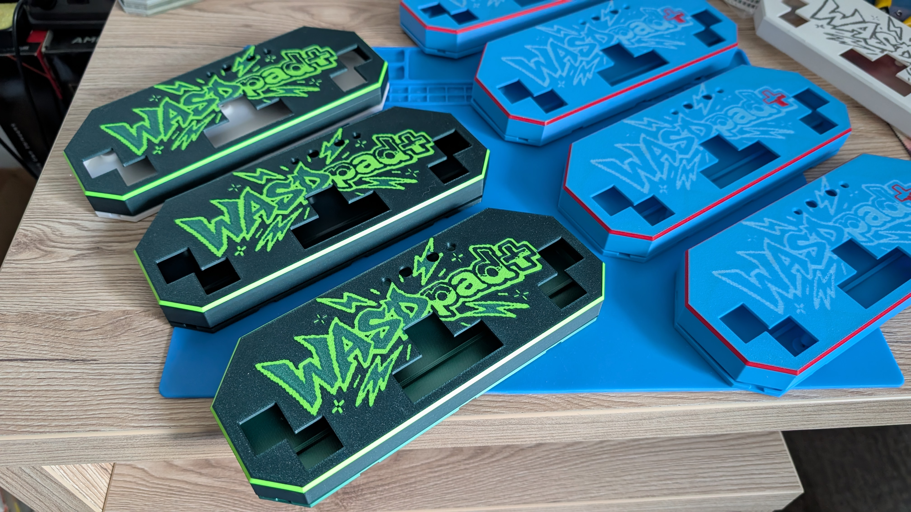

# WASDPad+

## Current release: WASDPad+ Rev1.5.2

**Final Production Release — physically manufactured and functionally validated.** A newly manufactured Rev1.5.2 PCB was received and its complete controller functionality was successfully confirmed by the project owner in October 2026. The physical Rev1.5.1 SPEED-switch mapping defect was corrected in the Rev1.5.2 schematic, PCB and production Gerber outputs. The fix is therefore validated on both a reworked Rev1.5.1 prototype and a newly fabricated Rev1.5.2 PCB.

The [Rev1.5.2 production release record](hardware/rev1.5/REV1.5.2_MANUFACTURING_RELEASE_NOTES.md) documents the manufacturing change and first-article functional validation. The [engineering erratum](hardware/rev1.5/REV1.5.1_TO_REV1.5.2_SPEED_SELECTOR_ERRATUM.md) and [legacy rework guide](docs/assembly/REV1.5.1_SPEED_SELECTOR_REWORK.md) preserve the original fault analysis. **Do not manufacture from unmodified Rev1.5.1 Gerbers.**

### Hardware WASD-style game controller for Commodore 64, Amiga and compatible retro computers

**Current Hardware:** Rev1.5.2  
**Status:** Final Production Release — functional validation PASS  
**Architecture:** Pure hardware — no MCU, firmware or drivers  
**Last Updated:** 2026-10-19

<p align="center">
  
</p>

<p align="center">
  <em>WASDPad+ — mechanical-switch game controllers built for classic computers.</em>
</p>

---

## Modern controls. Original hardware.

**WASDPad+** is a custom hardware game controller designed for classic computers using the traditional Atari-style digital joystick interface.

It combines the familiar precision of a keyboard-style WASD layout with an electrical architecture designed specifically for original retro hardware.

No USB conversion.  
No Bluetooth.  
No firmware.  
No software driver.  
No input polling.

**Just switches, discrete hardware and the original computer.**

The current **Rev1.5.2** hardware is the finalized, physically validated evolution of the WASDPad platform. It adds MX hot-swap support, hardware autofire, electrical protection, dual-colour status indication and subtle key backlighting while retaining a direct, deterministic hardware signal path.

---

# Why WASDPad?

Classic joystick games were built around digital inputs:

```text
UP
DOWN
LEFT
RIGHT
FIRE
```

Traditional joysticks translate these inputs through movement of a physical stick.

WASDPad takes a different approach.

The directional controls are individual mechanical keys arranged in a familiar keyboard-style layout. The result combines retro-computer electrical compatibility with the fast, precise feel of mechanical keyboard switches.

The controller does not emulate a joystick through software.

**Electrically, it is the joystick.**

---

# Rev1.5.2 Highlights

## Eight Mechanical Gameplay Switches

Rev1.5.2 provides eight primary gameplay controls:

```text
UP
DOWN
LEFT
RIGHT

FIRE1 LEFT
FIRE1 RIGHT

FIRE2 LEFT
FIRE2 RIGHT
```

The duplicated FIRE1 and FIRE2 controls create an ambidextrous layout.

---

## MX Hot-Swap

All eight gameplay switches use **Kailh MX-compatible hot-swap sockets**.

The production configuration uses **Gateron KS-8 Yellow** mechanical switches.

Switches can be replaced without soldering, making it possible to:

- replace worn switches
- experiment with different compatible switch types
- customize switch feel
- service the controller without PCB rework

---

## Hardware Autofire

FIRE1 includes a completely hardware-generated autofire system.

Two fixed autofire rates are available:

| Mode | Timing Resistance |
|---|---:|
| SLOW | 680 kΩ |
| FAST | 330 kΩ |

Physical selector orientation:

```text
LEFT  -> SLOW
RIGHT -> FAST
```

Autofire can be independently enabled or disabled.

When disabled, FIRE1 behaves as a conventional joystick fire button.

There is no firmware involved in generating the autofire pulses.

---

## Dual-Colour Autofire Status

A dedicated red/green LED provides visual feedback for the autofire system.

A separate red LED provides controller power indication.

The indication circuitry is separate from the primary gameplay signal path.

---

## Warm-White Key Backlighting

The Rev1.5 series provides subtle illumination beneath all eight gameplay switches.

Each key has an independently current-limited warm-white LED. The system is intentionally designed for restrained, functional illumination rather than high-brightness decorative lighting.

A dedicated hardware switch allows the entire backlight system to be turned on or off independently from controller operation.

---

# PCB evolution: Rev1.5.1 to final Rev1.5.2

Rev1.5.1 introduced the production-oriented hardware architecture; Rev1.5.2 corrected the SPEED-selector common contact mapping and is the final, functionally validated production revision.

<p align="center">
  
  
</p>

<p align="center">
  <em>Historical Rev1.5.1 PCB artwork — front and rear views. These images are not presented as photographs of the new Rev1.5.2 board.</em>
</p>

The PCB combines the gameplay interface, autofire generator, output switching, status indication, power protection and backlight control in a single two-layer design.

The Rev1.5.2 hardware retains a mixed assembly model with SMD electronics, THT user-interface components, bottom-side MX hot-swap sockets and manually installed mechanical components.

---

# Electrical Protection

Original retro computers were not designed around modern ESD and hot-plugging expectations.

The Rev1.5 hardware family therefore includes dedicated protection between the external controller environment and the host computer.

Protection includes:

- resettable +5 V overcurrent protection
- ESD protection on externally accessible joystick signals
- transient protection on the +5 V supply
- local supply decoupling
- GND copper zones on both PCB layers
- GND stitching vias

These functions operate automatically and require no user configuration.

---

# Direct Retro Hardware Interface

WASDPad+ does not insert a digital protocol between the player and the computer.

For normal manual inputs:

```text
Mechanical Switch
       │
       ▼
Hardware Signal Path
       │
       ▼
Host Joystick Input
```

There is no:

- USB polling interval
- wireless transmission
- firmware input scan
- operating-system driver
- software translation
- protocol conversion

This keeps the architecture deterministic and particularly suitable for latency-sensitive retro gaming.

---

# FIRE1 and FIRE2

Rev1.5.2 provides two independent fire functions.

### FIRE1

DE-9 pin 6.

Supports:

- manual fire
- hardware autofire

### FIRE2

DE-9 pin 9 / POTX.

Supports:

- independent manual second-fire input

FIRE2 functionality depends on the target computer and software.

Autofire applies to **FIRE1 only** in Rev1.5.2.

---

# DE-9 Interface

The controller follows the classic digital joystick interface architecture.

| DE-9 Pin | Function |
|---:|---|
| 1 | UP |
| 2 | DOWN |
| 3 | LEFT |
| 4 | RIGHT |
| 5 | Auxiliary / unused in current cable assembly |
| 6 | FIRE1 |
| 7 | +5 V |
| 8 | GND |
| 9 | FIRE2 / POTX |

The electrical pin number is authoritative.

Cable conductor colours are not considered authoritative because they may vary between manufacturing batches.

---

# Target Platforms

Primary development targets are:

- **Commodore 64**
- **Commodore 128**
- **Commodore Amiga**

The architecture may also work with other systems using electrically compatible Atari-style digital joystick interfaces.

Compatibility must be evaluated electrically — connector shape alone does not guarantee compatibility.

The Commodore Plus/4 family can be supported through an appropriate passive pin-mapping adapter.

---

# Hardware-Only by Design

Rev1.5.2 deliberately does **not** contain a microcontroller.

That is not an accidentally missing feature. It is part of the design philosophy.

The current generation prioritizes:

- deterministic behaviour
- low latency
- simplicity
- repairability
- low power consumption
- compatibility with vintage hardware
- understandable electronics
- long-term serviceability

There is no programmed component required for normal controller operation.

---

# Designed as a Complete Controller

<p align="center">
  
</p>

WASDPad+ is developed as a complete controller platform rather than only as an electronic circuit.

The project includes:

- custom PCB electronics
- component selection
- mechanical switch layout
- custom enclosure design
- 3D-printed enclosure production
- assembly planning
- manufacturing documentation
- validation procedures

The enclosure and PCB are developed together so that switch position, user controls, status indicators, cable routing and serviceability form one integrated design.

---

# PCB and Manufacturing Engineering

**Final design baseline: Rev1.5.2.** The corrected schematic uses `Switch:SW_SPDT`, with the physical SPEED switch's centre **pad 2** connected to `AF_EN_P`:

| Switch pad | Correct Rev1.5.2 connection | Function |
| --- | --- | --- |
| 1 | `AF_FAST_SEL` → CD4066 U2 pin 5 | FAST (pads 1–2 closed) |
| 2 | `AF_EN_P` | Common / autofire enable |
| 3 | `AF_SLOW_SEL` → CD4066 U2 pin 13 | SLOW (pads 2–3 closed) |

The Rev1.5.2 schematic and PCB were corrected, and matching Gerber manufacturing outputs were generated and used for the successfully manufactured design (project-owner report). Earlier reported design checks: **ERC 0 errors / 0 warnings**, PCB **DRC 0 errors / 0 unconnected pads**, with **46 recorded custom-footprint/J1 warnings** requiring separate review documentation. These warnings must not be mistaken for unresolved SPEED-selector function failures.

The newly fabricated Rev1.5.2 unit has passed full reported controller functionality tests. Hardware manufacturing data in this repository should not be confused with the complete production handoff: the uploaded ZIP contains **Rev1.5.1-labelled historical BOM/CPL files**, but no Rev1.5.2 KiCad files, Gerber archive or revision-specific BOM/CPL to independently verify. See the [manufacturing release record](hardware/rev1.5/REV1.5.2_MANUFACTURING_RELEASE_NOTES.md).

---

# Current Release Status

## WASDPad+ Rev1.5.2 — Final Production Release

**Physical validation: PASS (manufactured Rev1.5.2 hardware, project-owner confirmation, October 2026).**

- [x] Corrected physical SPEED-switch common-pad assignment in Rev1.5.2 schematic and PCB
- [x] Updated Gerber fabrication outputs and manufactured a new Rev1.5.2 PCB
- [x] Repaired and functionally tested a legacy Rev1.5.1 board
- [x] Tested a **newly manufactured Rev1.5.2** controller; all reported functions passed
- [x] Confirmed the FAST/SLOW SPEED-selector correction works on the manufactured revision
- [x] Retained the pure-hardware architecture, hot-swap switching, dual FIRE inputs, ESD/overcurrent protection and backlighting
- [x] Closed the Rev1.5.2 functional validation milestone

**Evidence boundary:** The first-article PASS is reported by the project owner; this public documentation ZIP does not include original electrical logs or the exact production Gerber/BOM/CPL dataset. Normal per-unit quality control, release traceability and production-batch acceptance remain applicable to each future lot. This is not a claim that every future board has already been tested.

**Legacy Rev1.5.1:** Unmodified boards have a known SPEED fault and must not be used as the fabrication baseline; already manufactured boards may be [reworked individually](docs/assembly/REV1.5.1_SPEED_SELECTOR_REWORK.md).

---

# Release Path

```text
Rev1.5.1 engineering review (historical)
                 │
                 ▼
Physical test identified SPEED common-pad fault
                 │
                 ├──► Existing Rev1.5.1 PCB reworked and gameplay tested: PASS
                 │
                 ▼
Rev1.5.2 schematic / PCB / manufacturing Gerbers corrected
                 │
                 ▼
New Rev1.5.2 PCB manufactured
                 │
                 ▼
Full functional test of manufactured Rev1.5.2: PASS
                 │
                 ▼
     REV1.5.2 FINAL PRODUCTION RELEASE
                 │
                 ▼
     Stable maintenance / future Rev2.0 R&D
```

Future production units should receive the standard incoming and end-of-line checks described in the [assembly and test procedure](docs/assembly/ASSEMBLY.md).

---

# Documentation

Start with the [documentation index](docs/README.md). Current release and technical references:

- [Rev1.5.2 feature specification](docs/specification/FEATURE_SPECIFICATION.md)
- [Rev1.5.2 system architecture](docs/architecture/System_architecture.md)
- [Rev1.5.2 hardware overview](hardware/rev1.5/README.md)
- [Rev1.5.2 production and first-article validation record](hardware/rev1.5/REV1.5.2_MANUFACTURING_RELEASE_NOTES.md)
- [Rev1.5.1 → Rev1.5.2 engineering erratum](hardware/rev1.5/REV1.5.1_TO_REV1.5.2_SPEED_SELECTOR_ERRATUM.md)
- [Historical Rev1.5.1 engineering review](hardware/rev1.5/Rev1.5.1-Engineering-Manufacturing-Record.MD)
- [Rev1.5.1 field rework instructions](docs/assembly/REV1.5.1_SPEED_SELECTOR_REWORK.md)
- [Assembly and DE-9 cable verification](docs/assembly/ASSEMBLY.md)
- [Development roadmap and future Rev2.0](docs/roadmap/ROADMAP.md)

---

# Manufacturing Documentation

The released Rev1.5.2 design and corresponding Gerbers have successfully produced a functionally validated PCB (project-owner confirmation). The public repository ZIP, however, currently contains **only Rev1.5.1-named** [Master BOM](hardware/rev1.5/bom/WASDPad_Rev1.5.1_FULL_MASTER_BOM.csv) and [Master CPL](hardware/rev1.5/bom/WASDPad_Rev1.5.1_FULL_MASTER_CPL.csv). These files are retained as **historical Rev1.5.1 manufacturing records**; their applicability to Rev1.5.2 must not be presumed merely from filenames or the absence of a change in component selection.

- [Rev1.5.2 manufacturing release status and test evidence](hardware/rev1.5/REV1.5.2_MANUFACTURING_RELEASE_NOTES.md)
- [Historical Rev1.5.1 component documentation](hardware/rev1.5/bom/README.md)
- [Historical Rev1.5.1 datasheet index](hardware/rev1.5/datasheets/WASDPad_Rev1.5.1_DATASHEET_INDEX.md)
- [Approved alternate-part policy (Rev1.5.1 baseline)](hardware/rev1.5/bom/ALTERNATE_PARTS.md)
- [Procurement notes (Rev1.5.1 baseline)](hardware/rev1.5/bom/PROCUREMENT_NOTES.md)

**For manufacturing a new Rev1.5.2 lot, use the matching current Gerber/drill, BOM and CPL records from the actual Rev1.5.2 release package**, not a mixture of archived revisions. This ZIP alone is not a substitute for that fabrication package.

---

# Serviceability

Rev1.5.2 retains the hardware platform’s serviceability.

The controller uses:

- replaceable MX gameplay switches
- hot-swap sockets
- conventional discrete components
- documented semiconductor and passive components
- standard electronic packages
- replaceable external cable
- no programmed device required for operation

This makes the hardware suitable not only for manufacture, but also for long-term maintenance.

---

# Evolution: Rev1.2 → Rev1.5.1 → Rev1.5.2

```text
Rev1.2 — proven digital control and hardware autofire
   │
   ▼
Rev1.5.1 — protection, hot-swap, key illumination,
            dual-colour status and manufacturing-oriented design
   │
   ├── Physical prototype revealed SPEED selector common-pad error
   ├── Existing board reworked and validated on Amiga 1200
   ▼
Rev1.5.2 — corrected SPDT symbol/pad mapping and PCB routing,
            matching production Gerbers, new fabricated board
   │
   ▼
FULL FUNCTIONAL VALIDATION PASSED — FINAL PRODUCTION RELEASE
```

The Rev1.5.1 engineering record and rework instructions remain in the repository for traceability, not as the current manufacturing baseline.

---

# Future Rev2.0

A future Rev2.0 may explore a programmable architecture.

Possible concepts include:

- MCU-controlled autofire
- adjustable firing rates
- burst-fire modes
- configurable debounce
- game-specific profiles
- persistent configuration
- programmable indication
- USB configuration
- optional USB HID support

An MCU platform such as the **RP2040 family** may be evaluated.

Rev2.0 is intentionally separated from the stable Rev1.5.2 hardware platform.

The Rev1.5.2 platform is now a completed and physically validated discrete-hardware release; any future programmable functions belong in Rev2.0.

---

# Project Credits

WASDPad+ is the result of collaborative electronics, mechanical and testing work.

**Original WASDPad concept:** Tibor Puskás  
**PCB design & engineering :** STINGER / Krisztián Csere  
**3D modelling - enclosure:** Dester3D / Sándor Sebesi  
**Testing:** Megott / Norbert Krisztián

The Rev1.5.1 PCB also carries a small tribute to the Commodore 64 and the retro-computing community that inspired the project.

---

# License and Project Use

See the project legal documentation:

- [Licensing](docs/legal/LICENSES.md)
- [Trademarks](docs/legal/TRADEMARKS.md)

Publication of documentation or temporary public availability of this repository does not by itself grant rights beyond those explicitly stated in the project licensing documentation.

Third-party product names and trademarks remain the property of their respective owners.

---

# Project Snapshot

| | |
|---|---|
| **Project** | WASDPad+ |
| **Current Hardware** | **Rev1.5.2** |
| **Release** | **Final Production Release — manufactured hardware tested** |
| **Functional first-article validation** | **PASS — project-owner confirmed, October 2026** |
| **Architecture** | Discrete / hardware-only, no firmware |
| **Interface** | DE-9 digital joystick |
| **Primary Platforms** | Commodore 64 / 128 / Amiga architecture; platform-specific compatibility applies |
| **Gameplay Switches** | 8 × MX-compatible hot-swap |
| **Fire Inputs** | FIRE1 + FIRE2 |
| **Autofire** | Hardware / FIRE1 / OFF–SLOW–FAST |
| **Key Backlight** | 8 × warm-white LED |
| **Protection** | PPTC + signal ESD + +5 V TVS |
| **SPEED selector** | Rev1.5.2 corrected pin-2 common mapping |
| **Historical documentation** | Rev1.5.1 preserved for engineering traceability |

---

<p align="center">
  <strong>WASDPad+ Rev1.5.2 — Final Production Release</strong><br>
  Direct hardware. Mechanical switches. No firmware between you and the game.
</p>
