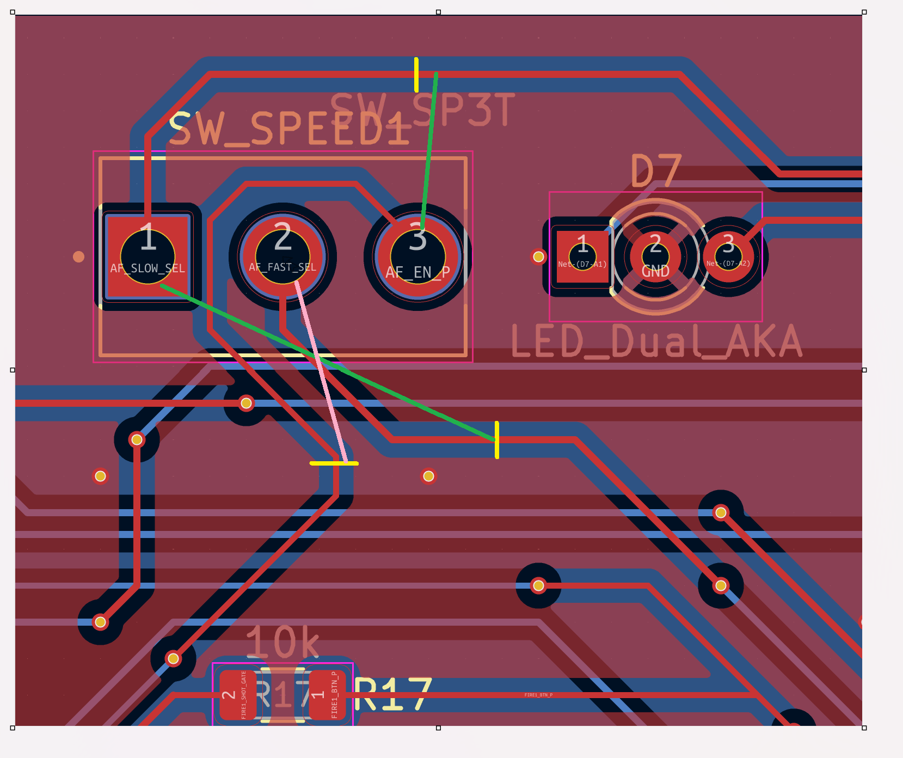
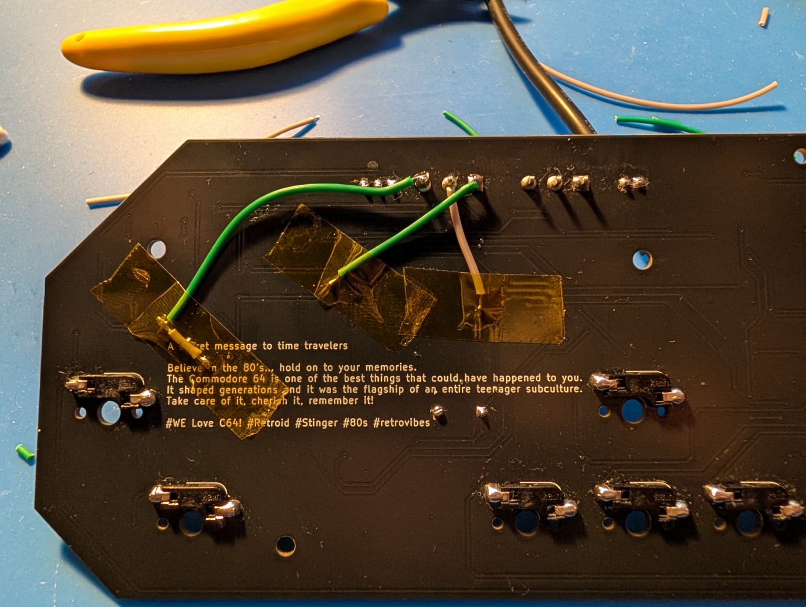

# WASDPad+ Rev1.5.1 — SPEED Selector PCB Rework Procedure

**Document revision:** 1.2  
**Date:** 2026-10-16  
**Applies to:** Original, uncorrected WASDPad+ Rev1.5.1 PCB assemblies and compatible unpopulated PCBs  
**Validated scope:** One reworked assembled controller passed reported real-world Amiga 1200 gameplay tests  
**Engineering reference:** [Rev1.5.1 to Rev1.5.2 SPEED Selector Erratum](../../hardware/rev1.5/REV1.5.1_TO_REV1.5.2_SPEED_SELECTOR_ERRATUM.md)  
**Production baseline:** **Rev1.5.2 final PCB and updated Gerbers — newly manufactured Rev1.5.2 unit fully functionally validated (project-owner confirmation, October 2026).** This guide is for salvaging already fabricated **Rev1.5.1** boards; it is **not** an instruction to patch new Rev1.5.2 production PCBs.

> **Important:** This procedure documents an actual successful physical patch, but cut and scrape locations must be confirmed by examining the specific PCB revision. Use an unpowered continuity meter, good magnification, and the original KiCad F.Cu/B.Cu layout. A mistaken trace cut or solder bridge may make the controller unsafe for the connected host.

## 1. What is wrong?

The original Rev1.5.1 `SW_SPEED1` PCB used a symbol with a schematic common **pin 3**, while the installed three-terminal switch has a physical common **pad 2**. As fabricated, the SPEED switch nets were rotated by one pad and FAST did not work.

Viewed from the **component/front side**, the original PCB has:

| SPEED pad | Original Rev1.5.1 net | Correct net after rework |
| --- | --- | --- |
| 1 (left) | `AF_SLOW_SEL` | `AF_FAST_SEL` |
| **2 (center)** | `AF_FAST_SEL` | **`AF_EN_P`** |
| 3 (right) | `AF_EN_P` | `AF_SLOW_SEL` |

**From the PCB rear side the left/right order is mirrored:** pad 3 appears to the left of pad 2; pad 1 appears to its right. Always use pad numbers and an unpowered continuity test, not just visual left/right position.

## 2. Reference images

### Front-side cut and jumper concept

**Image key:** yellow = three isolation cuts; green = FAST/SLOW jumper targets; pink = common enable jumper. This is a **planning sketch**, not a drill template. The actual verified patch was routed on the PCB rear side.

### Rear-side prototype rework, photographed

The photograph records the actual first rework. Kapton tape may be used to hold leads during soldering; finish and mechanical strain relief should be assessed separately.

## 3. Required equipment

- Unpowered continuity-capable multimeter and adjustable, current-limited 5 V supply
- Magnifier/microscope and a fine-point scalpel or fiberglass pen for localized solder-mask removal
- Fine soldering iron, appropriate flux, solder and thin **insulated** patch wire (approximately 0.15–0.2 mm conductor)
- IPA for post-solder cleaning, protective UV-curable solder mask/lacquer and a suitable UV curing light
- ESD-safe work surface and Kapton tape for temporary positioning

## 4. Isolation and jumper plan

**Power off and disconnect the controller completely from every host and bench supply before cutting, scraping or measuring continuity.**

1. Identify the `SW_SPEED1` footprint and the three original F.Cu outgoing traces in the Rev1.5.1 PCB file.
2. Find an accessible segment in each of the three old `AF_SLOW_SEL`, `AF_FAST_SEL` and `AF_EN_P` traces. In the reference image the three cuts are yellow. Verify that any vias or B.Cu traces cannot bypass a proposed cut.
3. Make **three narrow, controlled copper interruptions**. Verify each interruption electrically before continuing. Do not rely on cutting solder mask alone—the underlying copper must actually be severed.
4. On the rear side, use the existing **plated through-hole SPEED switch solder terminals** as jumper origins; no additional drilled holes or switch removal are required.
5. Locate sound, solderable B.Cu portions of the three required destination nets. The vias on this board are solder-mask covered, so a short, straight B.Cu trace segment can be a safer attachment target than trying to heat a plated via. Gently expose **only** the copper required, stopping as soon as clean copper appears.
6. Solder the three wires to establish the corrected paths:

   | Rear-side origin | Required destination | Reference measurement node |
   | --- | --- | --- |
   | `SW_SPEED1` pad **1** | `AF_FAST_SEL` | U2 pin **5** |
   | `SW_SPEED1` pad **2** | `AF_EN_P` | R12 pad **2** |
   | `SW_SPEED1` pad **3** | `AF_SLOW_SEL` | U2 pin **13** |

7. Keep each patch wire insulated across other tracks, avoid mechanical tension, and route clear of mounting hardware, hot-swap sockets and enclosure contact surfaces.

**Do not attach a new wire on the wrong side of a copper cut.** Always verify a proposed solder site with the intended destination reference point and the switch pad isolated as required.

## 5. Pre-power electrical checklist

All tests below are performed with **power OFF, controller physically disconnected and multimeter in continuity mode**. The SPEED position matters because the common physical pad 2 intentionally closes to one side.

| Test | SPEED position | Test nodes | Expected |
| --- | --- | --- | --- |
| Old SLOW net isolated from pad 1 | FAST | SW_SPEED1 pin 1 ↔ U2 pin 13 | **OL / no beep** |
| New SLOW jumper continuous | FAST | SW_SPEED1 pin 3 ↔ U2 pin 13 | **Beep** |
| New FAST jumper continuous | SLOW | SW_SPEED1 pin 1 ↔ U2 pin 5 | **Beep** |
| New enable jumper continuous | FAST | SW_SPEED1 pin 2 ↔ R12 pad 2 | **Beep** |
| Old enable net isolated from pad 3 | FAST | SW_SPEED1 pin 3 ↔ R12 pad 2 | **OL / no beep** |
| Old FAST net isolated from pad 2 | SLOW | SW_SPEED1 pin 2 ↔ U2 pin 5 | **OL / no beep** |
| Supply short check | AUTO OFF | U2 pin 14 (+5 V) ↔ pin 7 (GND) | **No sustained beep** |

These expected readings were verified on the first successful patched prototype. If any result disagrees, do not power the board. Check the switch position, meter mode, isolation cuts, solder bridges and jumper destinations.

## 6. Bench power-on check

After successful power-off tests:

1. Apply **5.0 V** from a current-limited bench supply (initial limit approximately **100 mA**); do **not** power from a retro computer for initial electrical checkout.
2. Confirm that the supply stays in **CV** operation and does not trip its current limit.
3. Switch AUTO **ON**, SPEED **FAST**. Confirm that the power LED illuminates and the **red FAST** status LED activates.
4. Check the timer output, U1 pin 3 (`AF_CLK`). The successful prototype showed about **2.199 V DC average** in FAST and **2.2 V DC average** in SLOW. These are example voltmeter readings, **not frequency specifications**.
5. Switch SPEED to **SLOW** and confirm the SLOW indicator/behavior without disturbing other controller functions.
6. Turn AUTO **OFF** and confirm that manual FIRE1 is available without unintended autofire action.

If unexpected heating, supply current limiting or malfunction occurs, switch power off immediately and investigate.

## 7. Real-system functional validation

A patch is not considered accepted until the complete controller functions correctly on a representative host. The first reworked board passed real gameplay testing on an **Amiga 1200**, including all reported controller functions and both FAST and SLOW autofire settings.

Repeat and record at least: direction inputs, FIRE1 manual operation, FIRE2, AUTO OFF / ON, FAST/SLOW differentiation, both status LEDs, hot-swap control functionality and real gameplay.

**Validation outcome:** the measured fault was corrected on an already-assembled Rev1.5.1 board. All reported controller functions passed during an actual Amiga 1200 gameplay session. This proves the rework on that unit and supports the corrected selector design; it does **not** claim that all original Rev1.5.1 stock has been repaired or tested. **Separately, an actual newly manufactured Rev1.5.2 unit has now passed full reported functionality** (owner confirmed); see the [Rev1.5.2 release record](../../hardware/rev1.5/REV1.5.2_MANUFACTURING_RELEASE_NOTES.md).

## 8. Finishing

After all electrical and gameplay checks pass, remove excess flux and clean only with materials compatible with the components and PCB. Inspect under magnification and add appropriate mechanical slack/strain relief to every jumper. Apply UV-curable solder mask or electronics-grade protective coating sparingly over exposed copper/patch connections, then cure according to its manufacturer's instructions. Do not coat mating surfaces or make later service impossible.

Recheck that no patch wire rubs on the enclosure or hot-swap parts before declaring the individual unit accepted.

## 9. Rework acceptance and traceability

Record for each PCB:

- Original PCB revision and unit/serial identification (if any)
- Date and operator
- Exact isolation/jumper locations (photos recommended)
- Power-off connectivity checks and no-shorts result
- Bench power-on results and supply current where measured
- Real host, game or test method, FAST/SLOW and FIRE test results
- Final coating, inspection and acceptance status

**Inventory at defect discovery:** four assembled Rev1.5.1 boards and six additional fabricated bare boards. **Current confirmed pass count:** one patched, gameplay-tested Rev1.5.1 board. Do not mark the other nine as passed until individually verified.

---

**Series-production design closure:** the Rev1.5.2 schematic uses `Switch:SW_SPDT` with common pin 2; the final PCB carries the corrected pad-to-net connections and its **updated production Gerber outputs** incorporate that correction (project-owner confirmation). The three-cut/three-jumper repair is only for existing Rev1.5.1 stock. See the [engineering erratum](../../hardware/rev1.5/REV1.5.1_TO_REV1.5.2_SPEED_SELECTOR_ERRATUM.md) and the [manufacturing release notes](../../hardware/rev1.5/REV1.5.2_MANUFACTURING_RELEASE_NOTES.md).
