# WASDPad+ — Photo and Media Gallery

Photographs, PCB design views and manufacturing media from the WASDPad+ project. The **current documented hardware revision is Rev1.5.2**. Rev1.5.1 material is retained below as historical engineering evidence, not as the current manufacturing baseline.

[Project overview](../../README.md) · [Rev1.5.2 production and validation record](../../hardware/rev1.5/REV1.5.2_MANUFACTURING_RELEASE_NOTES.md) · [Detailed enclosure gallery](../../enclosure/GALLERY.md) · [SPEED selector rework guide](../assembly/REV1.5.1_SPEED_SELECTOR_REWORK.md)

## Finished controllers and enclosure variants

| | |
|:---:|:---:|
| <a href="wasdpad_controllers.jpg">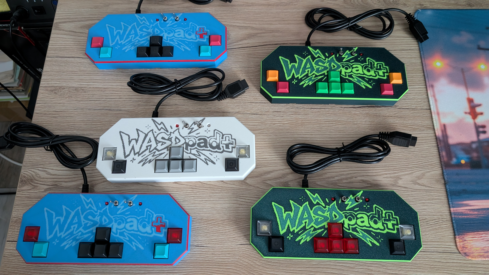</a> | <a href="wasdpad_enclosures.jpg">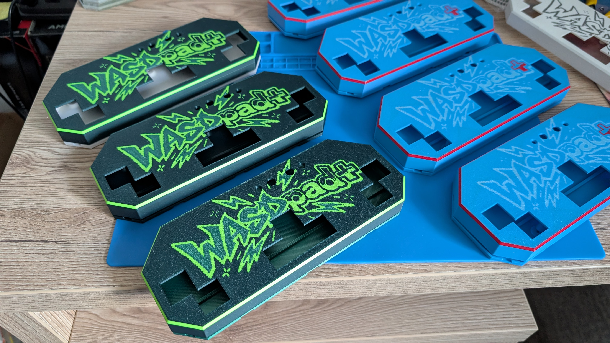</a> |
| **Finished controllers:** assembled WASDPad+ units with fitted cases and cables. | **Enclosure collection:** printed case variations and branding. |
| <a href="wasdpad_enclosure_variants_01.jpg">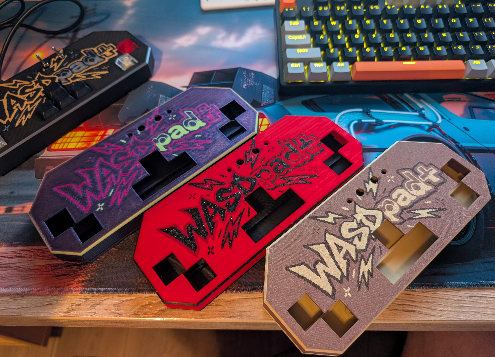</a> | <a href="wasdpad_enclosure_variants_02.jpg">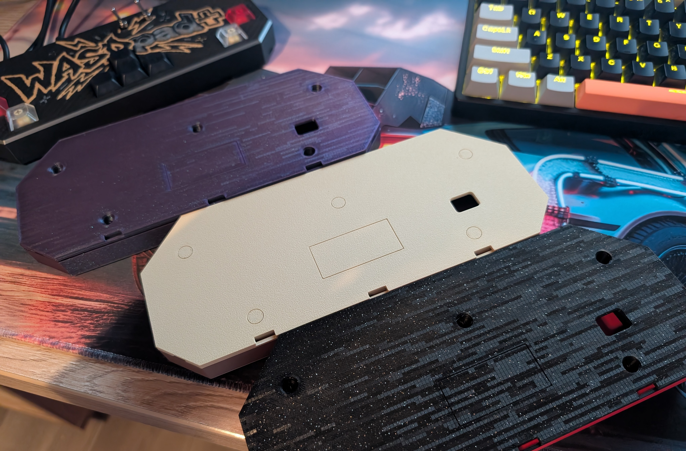</a> |
| **Upper enclosure variants:** alternative colours and logo finishes. | **Lower enclosure variants:** underside geometry and access openings. |

## Rev1.5.2 PCB design views

These two images are **PCB design renderings**, not photographs of an assembled board. For the documented C64/Amiga FIRE2 selector circuit and its validation status, consult the [selector engineering update](../../hardware/rev1.5/REV1.5.2_C64_AMIGA_FIRE2_SELECTOR_UPDATE.md).

| | |
|:---:|:---:|
| <a href="wasdpad_rev1.5.2_pcb_front.png">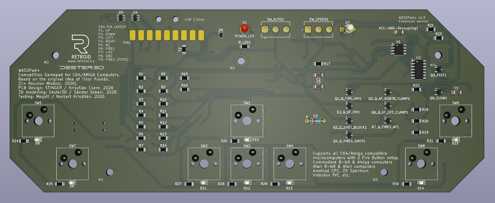</a> | <a href="wasdpad_rev1.5.2_pcb_back.png">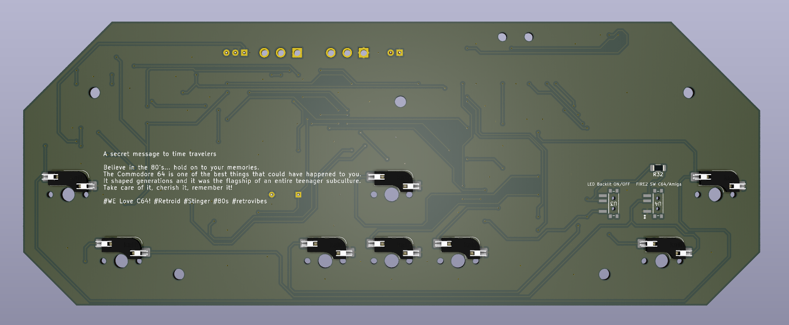</a> |
| **Front:** Rev1.5.2 PCB artwork, component side. | **Back:** Rev1.5.2 PCB artwork, switch-socket side. |

## Rev1.5.2 PCB manufacture and assembly

Photographs from PCB fabrication and surface-mount assembly. They document the physical production process; the functional validation outcome is recorded separately in the [manufacturing release notes](../../hardware/rev1.5/REV1.5.2_MANUFACTURING_RELEASE_NOTES.md).

| | |
|:---:|:---:|
| <a href="wasdpad_v1.5.2-smd-manuf01.jpg">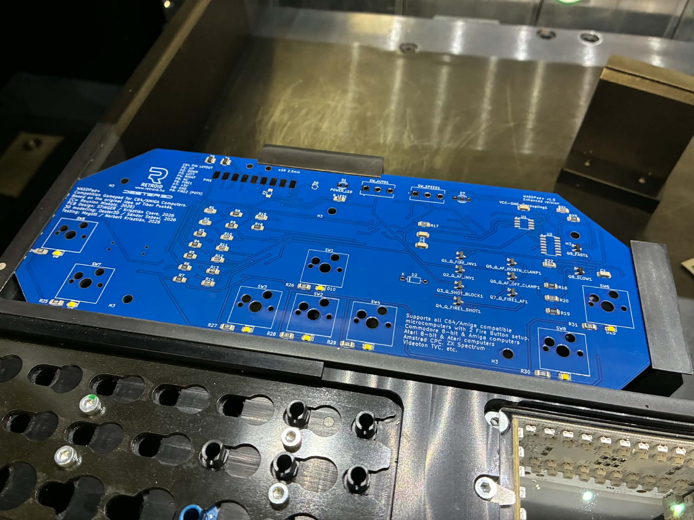</a> | <a href="wasdpad_v1.5.2-smd-manuf02.jpg">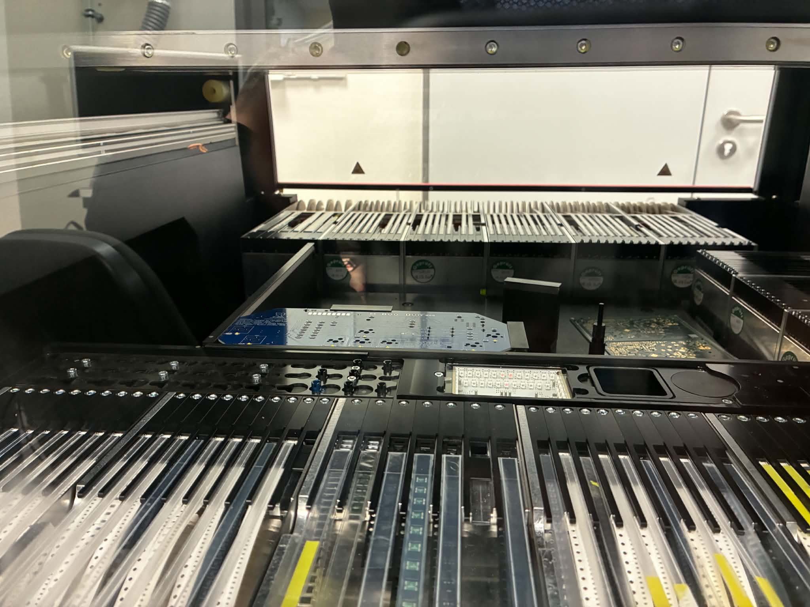</a> |
| **Manufacturing 01:** blue PCB positioned in production equipment. | **Manufacturing 02:** automated SMT workcell. |
| <a href="wasdpad_v1.5.2-smd-manuf03.jpg">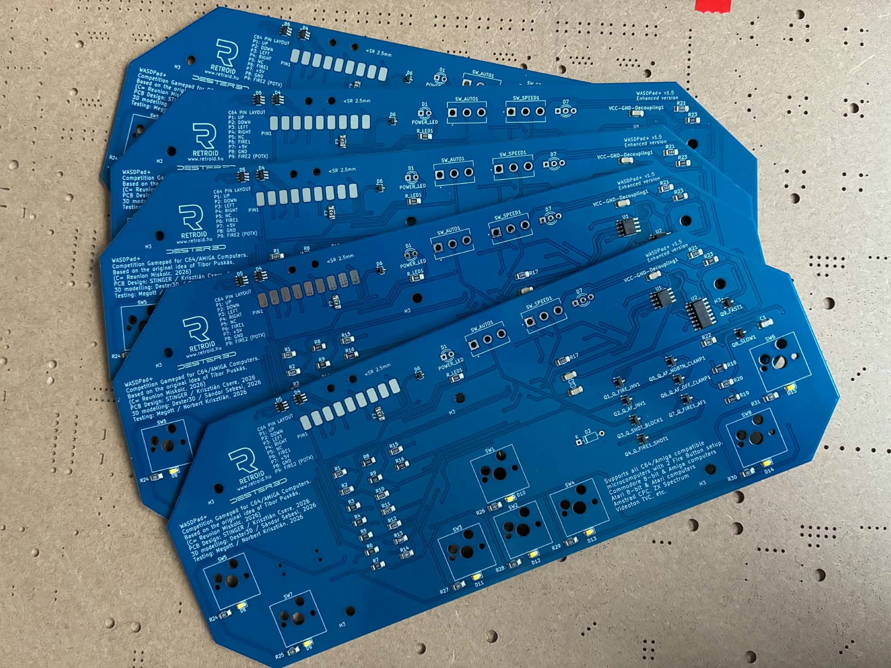</a> |   |
| **Manufacturing 03:** fabricated blue PCBs prior to final assembly. |  |

**Manufacturing video:** [Watch the Rev1.5.2 SMT assembly-process clip (MP4, approximately 14 seconds)](wasdpad_v1.5.2_smd-injection-video.mp4).

### Additional assembly photograph

| | |
|:---:|:---:|
| <a href="wasdpad_v1.5.2-smd-manuf04.jpg">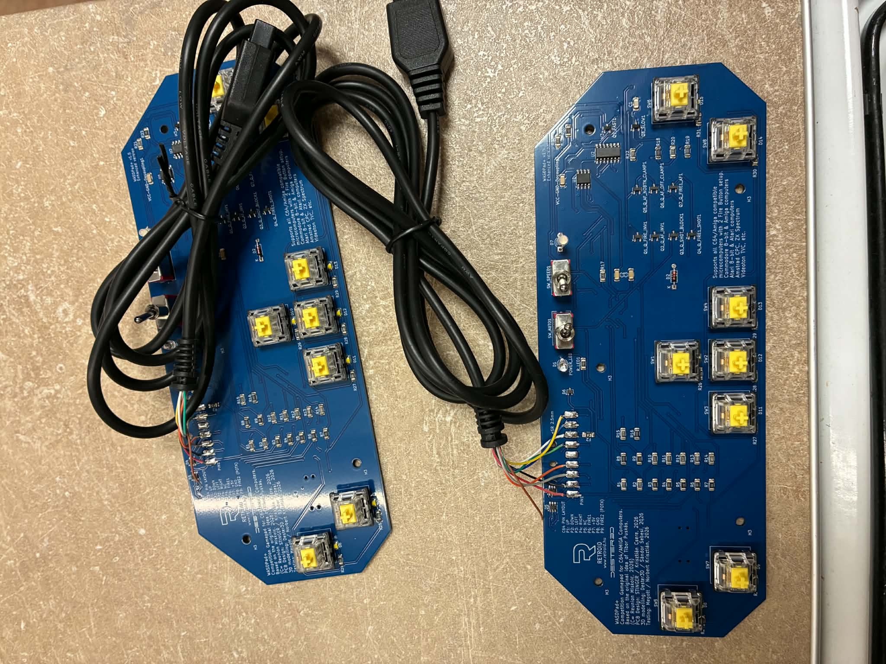</a> |   |
| **Assembly photograph:** two boards with fitted components and cables. |  |

> **Version-label note:** `wasdpad_v1.5.3-smd-manuf04.jpg` is the original uploaded filename. It is not being used here to announce or document a new Rev1.5.3 hardware release; the repository's current documented release remains **Rev1.5.2**.

## Historical Rev1.5.1 prototypes and PCB artwork

These images record earlier Rev1.5.1 designs and prototype work. **Do not use these views as the current Rev1.5.2 manufacturing reference.**

| | |
|:---:|:---:|
| <a href="wasdpad_rev1.5.1_pcb_front.png">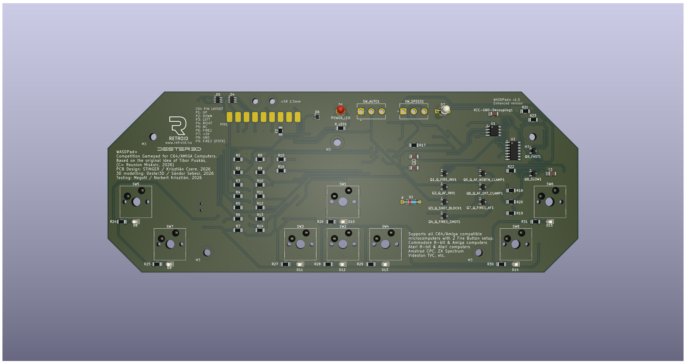</a> | <a href="wasdpad_rev1.5.1_pcb_back.png">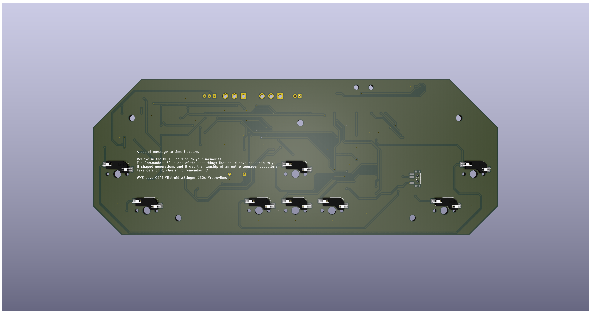</a> |
| **Rev1.5.1 front:** superseded PCB artwork. | **Rev1.5.1 back:** superseded PCB artwork. |
| <a href="wasdpad_rev1.5.1_pcb_proto.jpg">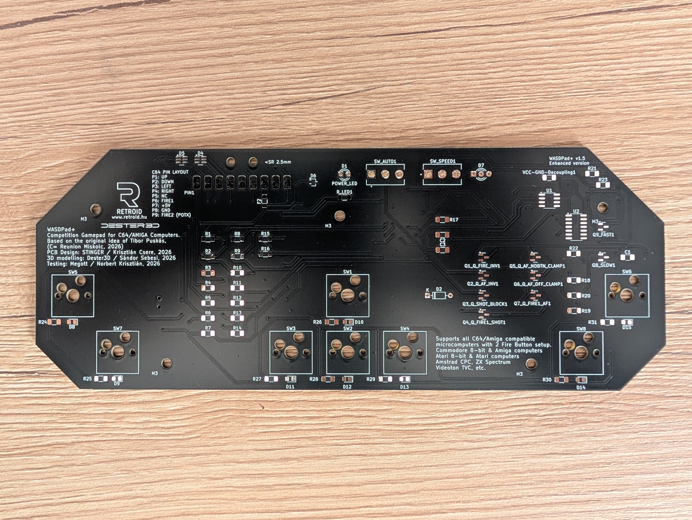</a> | <a href="wasdpad_v1.5.1_proto_working_01.jpg">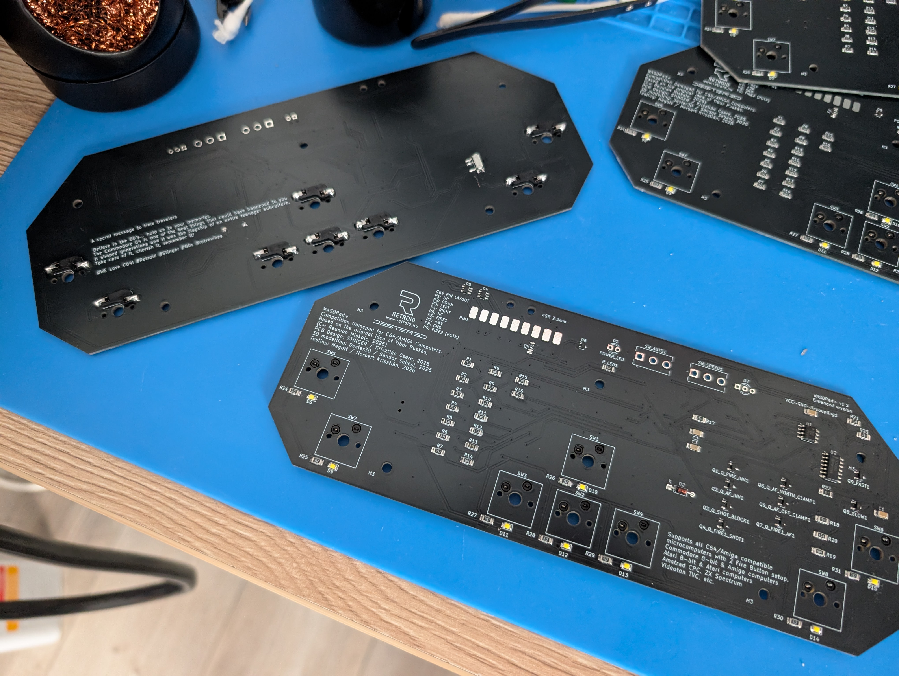</a> |
| **Prototype PCB:** early black board before final assembly. | **Prototype work 01:** PCB assembly and bench work. |
| <a href="wasdpad_v1.5.1_proto_working_02.jpg">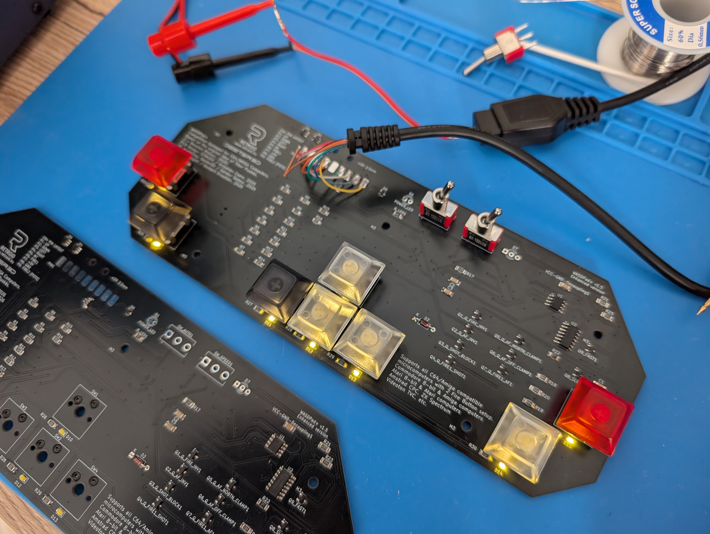</a> |   |
| **Prototype work 02:** mechanical switch and controller integration. |  |

## Historical Rev1.5.1 SPEED selector correction

These two images accompany the [Rev1.5.1 SPEED selector rework instructions](../assembly/REV1.5.1_SPEED_SELECTOR_REWORK.md). The Rev1.5.1 fault was corrected in the later Rev1.5.2 PCB design.

| | |
|:---:|:---:|
| <a href="rev151_speed_selector_cut_and_jumper_plan.png">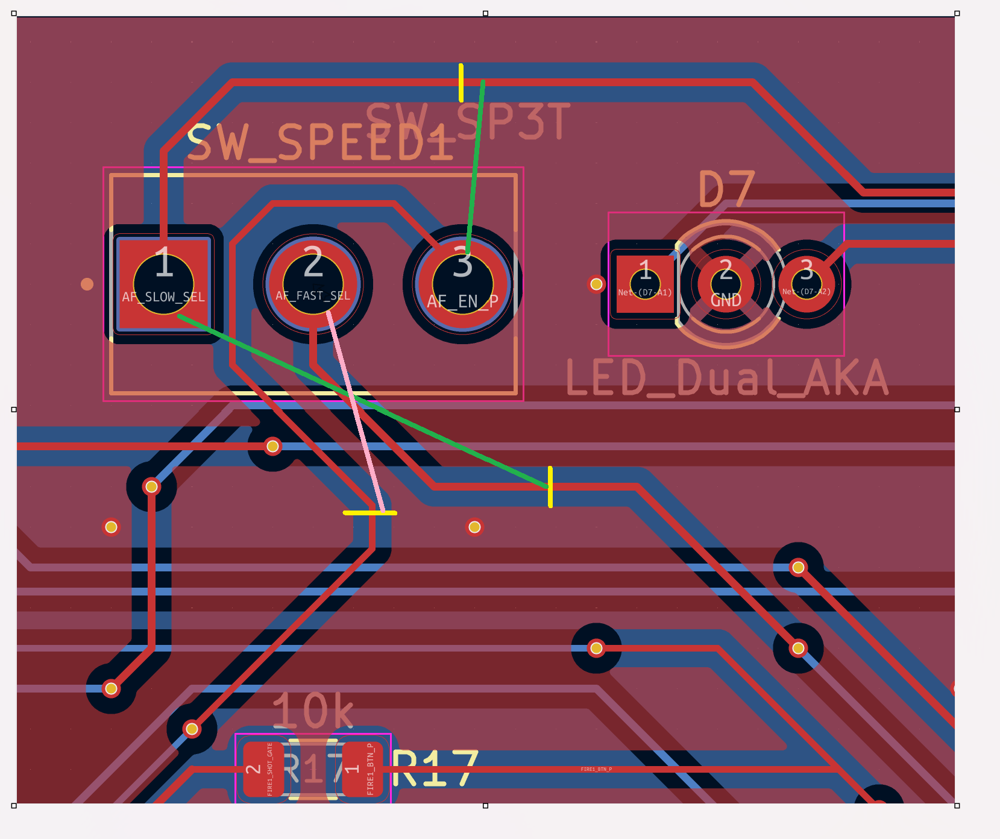</a> | <a href="rev151_speed_selector_reworked_back.jpg">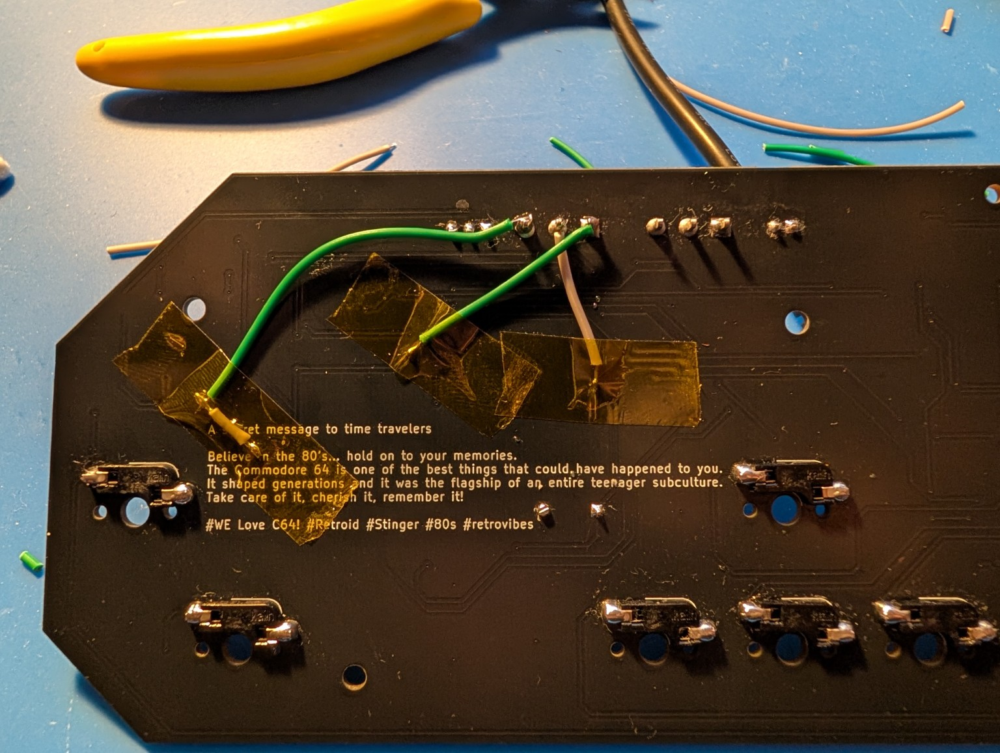</a> |
| **Repair plan:** marked trace isolation and jumper connections. | **Reworked board:** photographed underside after the legacy repair. |

---

**Media and revision guidance:** Image captions identify what is visible or what the source filename supports; a PCB rendering is not a physical test record. The separately reported, successfully tested selector-equipped Rev1.5.2 controller is described in the [production documentation](../../hardware/rev1.5/REV1.5.2_MANUFACTURING_RELEASE_NOTES.md). Use the matching released KiCad and fabrication outputs—not gallery photographs—for new board production.
